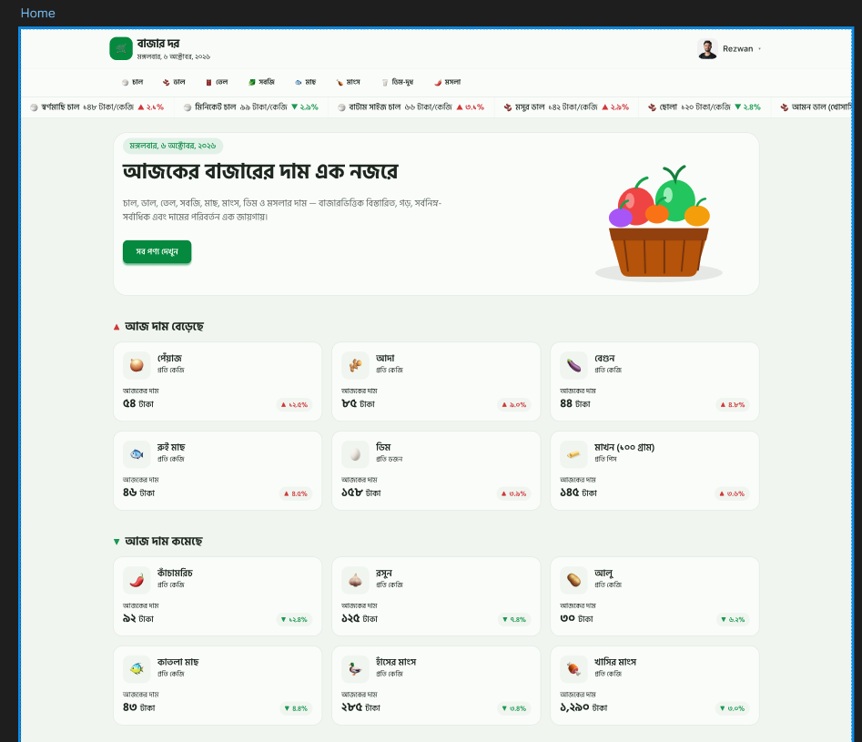

<div align="center">
  

  <h1>বাজার দর <sub>· Bazar Dor</sub></h1>

  <p><strong>আজকের বাজারের দাম — এক নজরে, এক জায়গায়।</strong></p>
  <p>A Bengali-first market price guide for everyday essentials across Bangladesh.</p>

  <p>
    
    
    
    
    
  </p>
</div>

<p align="center">
  
</p>

## About

**বাজার দর (Bazar Dor)** helps people quickly explore current prices for rice, lentils, oil, vegetables, fish, meat, dairy, and spices. Browse by category, compare market-level prices, and see which products are rising or falling — with a responsive interface designed around Bengali language and numerals.

## What you can do

| Feature | What it offers |
| --- | --- |
| **Market overview** | Browse every available product, with dedicated sections for the top six price risers and fallers. |
| **Category browsing** | Explore products by category and sort prices from low to high or high to low. |
| **Market comparison** | View minimum, maximum, and average prices alongside a market-by-market price breakdown. |
| **Accounts and protected pages** | Register or sign in with email and password, Google, or GitHub; product details and profile pages require authentication. |
| **Profile management** | View and update account information, with optional profile photo uploads through Cloudinary. |
| **Designed for comfort** | Use the persistent light/dark theme, responsive layouts, animated loading skeletons, accessible controls, and helpful toast notifications. |
| **Reliable product data** | Load product data through a server-side endpoint with a backup API and short-lived caching. |
| **Friendly recovery states** | Invalid routes and unknown products show a Bengali 404 page with a link home. |

## Technology

- **Framework:** Next.js 16 App Router with React 19
- **Styling:** Tailwind CSS 4 and HeroUI styles
- **Authentication:** Better Auth with MongoDB and the Better Auth MongoDB adapter
- **Market data:** Bazar Dor products API, with a backup endpoint
- **Notifications and icons:** React Hot Toast, Iconify, and Gravity UI icons
- **Hosting:** Vercel

## Run locally

### Requirements

- Node.js **20.9 or newer**
- npm
- A MongoDB connection string

### 1. Install dependencies

```bash
cd my-app
npm install
```

### 2. Configure environment variables

Create `my-app/.env.local` (or configure the same variables in your deployment provider). Never commit real secrets.

```env
BETTER_AUTH_URL=http://localhost:3000
BETTER_AUTH_SECRET=replace-with-a-long-random-secret
MONGODB_URL=mongodb+srv://<username>:<password>@<cluster>/<database>

# Optional: enable Google sign-in
GOOGLE_API_CLIENT_ID=
GOOGLE_API_CLIENT_SECRET=

# Optional: enable GitHub sign-in
GITHUB_API_CLIENT_ID=
GITHUB_API_CLIENT_SECRET=

# Optional: enable profile photo uploads
CLOUDINARY_CLOUD_NAME=
CLOUDINARY_API_KEY=
CLOUDINARY_API_SECRET=
```

Configure each OAuth provider to use the Better Auth callback URL for your app origin:

- Google: `http://localhost:3000/api/auth/callback/google`
- GitHub: `http://localhost:3000/api/auth/callback/github`

When deploying, use your production origin and add every required variable to the hosting provider's environment settings. Keep `BETTER_AUTH_SECRET`, database credentials, OAuth client secrets, and the Cloudinary API secret private.

### 3. Start the development server

```bash
npm run dev
```

Open [http://localhost:3000](http://localhost:3000).

## Useful commands

Run these from `my-app/`:

| Command | Description |
| --- | --- |
| `npm run dev` | Start the local development server. |
| `npm run lint` | Check the codebase with ESLint. |
| `npm run build` | Create an optimized production build. |
| `npm run start` | Serve the production build locally. |

## Project layout

```text
my-app/
├── public/                 # Logo, site icon, and hero artwork
├── src/
│   ├── app/
│   │   ├── (auth)/         # Sign-in and sign-up pages
│   │   ├── api/            # Better Auth, product data, and avatar upload routes
│   │   ├── category/[slug] # Category listing, sorting, and loading UI
│   │   ├── product/[slug]  # Protected product and market price details
│   │   ├── profile/        # Protected profile and profile editor
│   │   └── components/     # Shared navigation, cards, theme, and UI
│   └── lib/                # Authentication clients and product data access
└── next.config.mjs
```

## Product data

The application uses the [Programming Hero Bazar Dor API](https://openapi.programming-hero.com/api/bazardor) for its product collection, with the previously provided Bazar Dor endpoints retained as fallbacks. It validates responses on the server and briefly caches successful results to reduce repeat requests. The ticker uses the same-origin `/api/products` route, so product data is shared across the ticker and product pages without browser-side requests to the external API.

Useful upstream endpoints:

- All products: `https://openapi.programming-hero.com/api/bazardor/products`
- Products by category: `https://openapi.programming-hero.com/api/bazardor/products?category=chal`
- All categories: `https://openapi.programming-hero.com/api/bazardor/categories`

The upstream product service is maintained separately from this application. If market data is unavailable, the app presents an error or unavailable state rather than treating missing data as a valid product list.

## Deployment

This is a full-stack Next.js application, so deploy it using the Next.js/Vercel integration rather than as a static export. Before deploying:

1. Add the required Better Auth and MongoDB environment variables to the deployment project.
2. Set `BETTER_AUTH_URL` to the production site origin.
3. Add OAuth callback URLs for the production domain if Google or GitHub sign-in is enabled.
4. Add the Cloudinary variables if profile photo uploads are required.
5. Run `npm run lint` and `npm run build` from `my-app/`.

---

<div align="center">
  <sub>তথ্য সচেতন সিদ্ধান্তের জন্য — বাজারদর স্থান, সময় ও সরবরাহ অনুযায়ী পরিবর্তিত হতে পারে।</sub>
</div>
